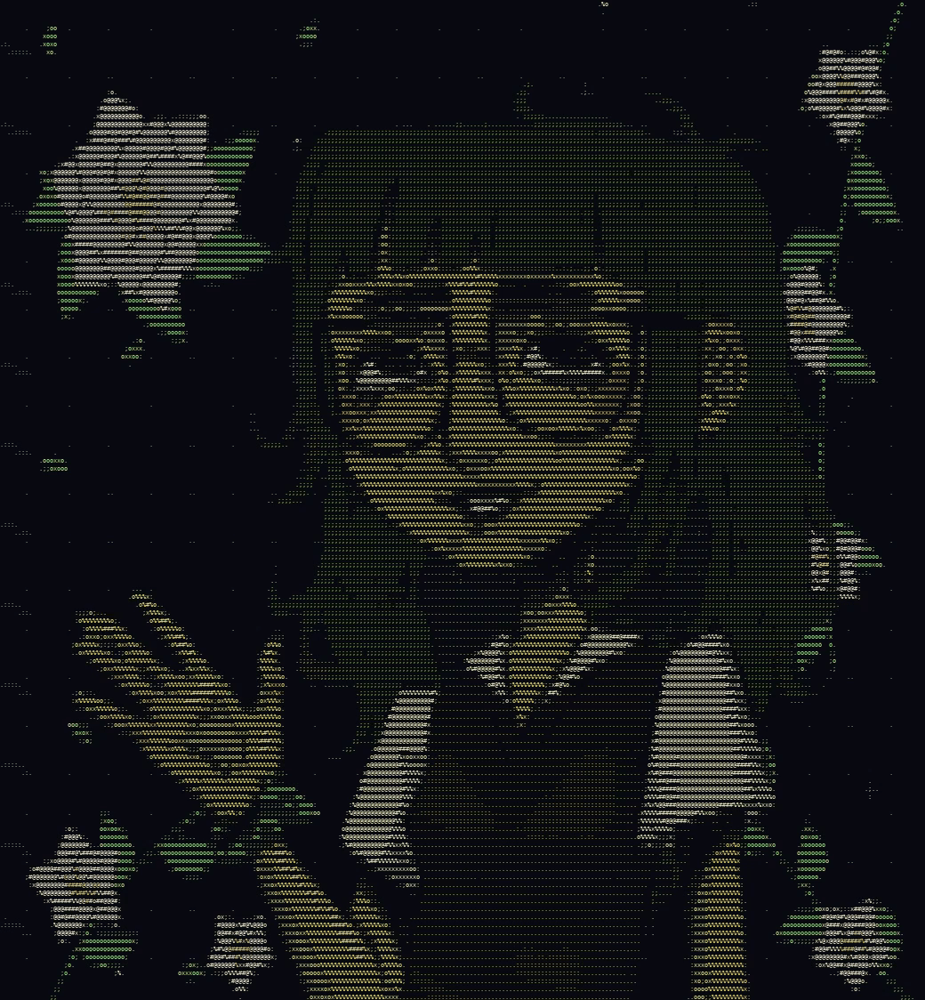

# Hola, soy Victoria

Hola, soy Victoria. Vengo del mundo de la animación y el arte para videojuegos, y hoy estoy enfocada en el desarrollo de software estudiando Analista Programador en Duoc UC, mientras trabajo de forma freelance como ilustradora.

En programación ya he desarrollado distintos proyectos: 

              ▪️ TraceFood: Desarrollo de un sistema para rastrear alimentos mediante códigos QR conectado a una base de datos en Oracle SQL.

              ▪️ App Android nativa: Aplicación creada en equipo con Kotlin y arquitectura MVVM.

              ▪️ Botathon 2026 (Teletón): Participación en el desarrollo de una automatización con Blue Prism durante una jornada intensiva, haciéndome cargo de la interfaz y el manejo de datos.

---

## Proyectos

| Proyecto | Qué es |
|---|---|
| [**Trad_NDS_T**](https://github.com/VictoriaArias-i/Trad_NDS_T) | Códigos en Python para traducir un juego de DS |
| [**ascii-animation**](https://github.com/VictoriaArias-i/ascii-animation) | Mi dibujo animado en ASCII: mano saludando, parpadeo y pelo (la animación de arriba) |

## Stack

## Ahora

Aprendiendo animación y arte generativo con Python.
